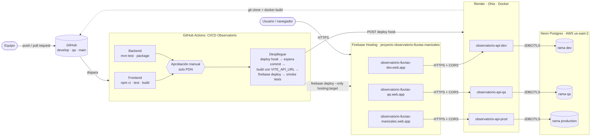

# Arquitectura

## Diagrama

El aislamiento es completo por ambiente: cada frontend llama únicamente a su API, y cada API se conecta únicamente a su base de datos.

- El frontend conoce su API porque `VITE_API_URL` se fija en el build.
- La API solo acepta peticiones de su frontend gracias a `APP_CORS_ORIGINS`.
- Cada API tiene sus propias credenciales de base de datos.

## Componentes

| Capa | Servicio | Configuración |
|---|---|---|
| Código | GitHub, repositorio `santiago270903/observatorio-lluvias-manizales` | Una rama por ambiente: `develop`, `qa` y `main`. |
| CI/CD | GitHub Actions | Un solo workflow con jobs de pruebas y un job de despliegue. Los *Environments* `dev`, `qa` y `production` tienen secretos propios; `production` exige un revisor. |
| Frontend | Firebase Hosting, plan Spark | Un proyecto con tres sitios, asociados a los targets `dev`, `qa` y `prod` en `.firebaserc`. Es una SPA: todas las rutas se reescriben a `/index.html`. Hay HTTPS y CDN por defecto. |
| API | Render Web Service, plan Free | Tres servicios Docker construidos desde `backend/Dockerfile`. *Auto-Deploy* está apagado: solo despliega el pipeline mediante el *deploy hook*. El *health check* es `/actuator/health`. |
| Base de datos | Neon Serverless Postgres, plan Free | Un proyecto con tres ramas (`production`, `qa` y `dev`). Cada rama tiene su propio cómputo y su propio *endpoint*. |

## Flujo de un cambio

1. El desarrollador hace push a `develop`.
2. Corren las pruebas del frontend y del backend en paralelo. Si alguna falla, el pipeline se detiene.
3. El job de despliegue llama al *deploy hook* de Render del ambiente. Render clona la rama, construye la imagen y la publica. Mientras tanto, el pipeline consulta `/actuator/info` hasta ver el commit nuevo. Ese valor sale de la variable `RENDER_GIT_COMMIT` que Render inyecta.
4. Con la API ya actualizada, el pipeline construye el frontend apuntando a ella y lo publica en el sitio de Firebase del ambiente.
5. Las pruebas de humo verifican cuatro cosas: que el *health* esté UP, que la API consulte la base de datos, que el frontend publicado apunte a su API y que el CORS sea correcto.
6. Para promover, se abre un PR `develop → qa`, que corre las pruebas; luego se hace el merge, que despliega QA, y se hacen las pruebas de aceptación. Después se abre un PR `qa → main` y se hace el merge. El despliegue a PDN espera la aprobación y, una vez aprobado, sigue los mismos pasos.

## Estrategia de persistencia

- **Servicio:** Neon, un PostgreSQL administrado y *serverless*. Es compatible con el PostgreSQL del `docker-compose.yml` local, así que la aplicación no cambia.
- **Aislamiento:** hay una rama de Neon por ambiente, y cada rama tiene su propio *endpoint* y sus datos independientes. Los datos de prueba de QA no llegan a PDN.
- **Esquema:** Hibernate lo crea y actualiza al iniciar (`spring.jpa.hibernate.ddl-auto=update`). Es adecuado para el alcance académico. En un sistema real se usarían migraciones versionadas con Flyway o Liquibase.
- **Acceso:**
  - solo las APIs de Render se conectan, por JDBC con TLS;
  - las credenciales viven únicamente en las variables de entorno de cada servicio de Render;
  - la base de datos no se expone como *endpoint* público de la aplicación;
  - la validación se hace a través de la API o de la consola de Neon.
- **Respaldo:** Neon conserva un historial que permite restaurar una rama a un punto anterior en el tiempo, con la ventana que ofrezca el plan gratuito.

## Por qué GitHub Actions y no Jenkins

El taller permite Firebase con un pipeline que use un "entorno protegido" para producción. GitHub Actions ofrece tres ventajas para este caso:

- es gratuito para repositorios públicos;
- no requiere mantener un servidor Jenkins;
- sus *Environments* resuelven la aprobación manual y los secretos por ambiente.

El `Jenkinsfile` del docente se conserva como referencia. Las etapas del workflow son equivalentes a las suyas: checkout, build y pruebas, y despliegue por rama con `input` para PDN.
